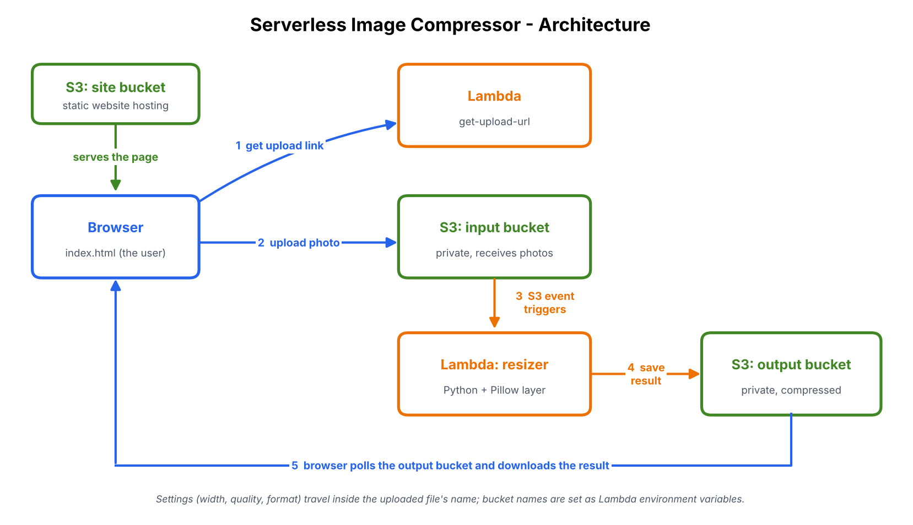
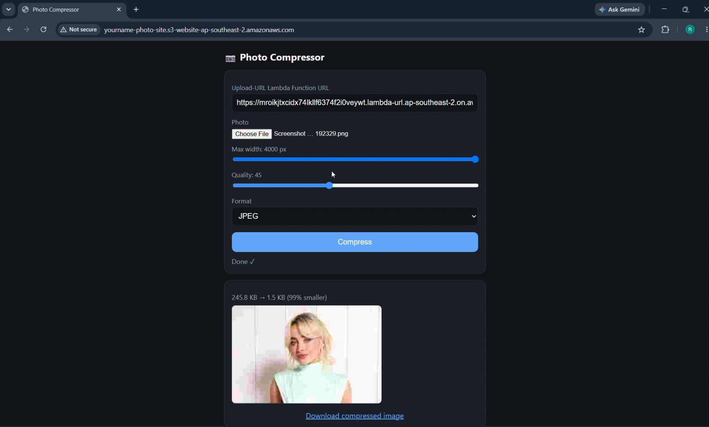
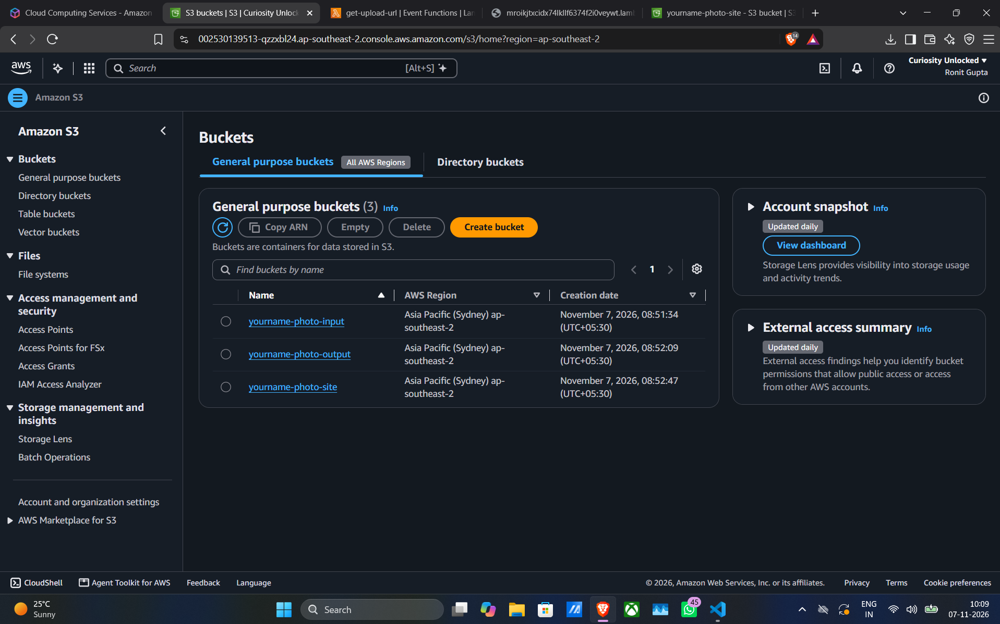
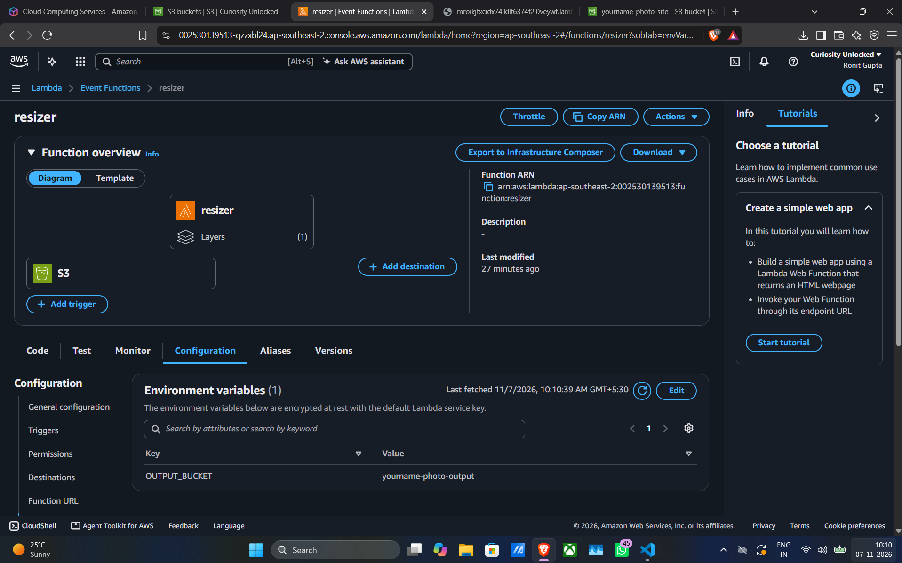

# Serverless Image Compressor

A fully serverless web app that resizes and compresses photos on AWS. Pick a photo, choose a max width,
quality and format, and get back a smaller copy in a few seconds - no servers to run.

**Built with:** Amazon S3 - AWS Lambda (Python 3.12) - Pillow - Lambda Function URLs - presigned URLs - vanilla HTML/JS

## Demo

<!-- Replace with your screen recording or GIF -->


## Architecture



1. The website (hosted in an S3 bucket) asks the **get-upload-url** Lambda for a temporary upload link.
2. The browser uploads the photo **directly to the private input bucket** using that presigned link.
3. The new file triggers an **S3 event**, which runs the **resizer** Lambda.
4. The resizer compresses the photo with Pillow and saves it to the **output bucket**.
5. The browser polls a temporary download link until the result is ready, then shows it with the size savings.

## Features

- Adjustable max width, quality and output format (JPEG, WebP, PNG)
- Fixes sideways phone photos (EXIF rotation)
- Large uploads: photos go straight to S3, so Lambda's 6 MB request limit does not apply
- Input and output buckets stay private; access is through short-lived presigned URLs
- Pay-per-use: costs nothing when idle

## How it works (design notes)

- **Settings travel in the filename.** The upload link is created for a key like
  `<id>__1280__75__JPEG` (width, quality, format). The resizer reads the settings back from the key name.
  Files uploaded by hand with a normal name use defaults (1280 px, quality 75, JPEG).
- **Environment variables** keep bucket names out of the code. `INPUT_BUCKET` and `OUTPUT_BUCKET` are
  set on the Lambda; the code reads them with `os.environ`.
- **No recursion.** The trigger listens only on the input bucket, and the resizer writes only to the
  output bucket, so results never re-trigger the function.

## Project structure

```
serverless-image-compressor/
├── README.md
├── architecture.png
├── lambda/
│   ├── resizer/lambda_function.py          # triggered by S3, compresses the image
│   └── get-upload-url/lambda_function.py   # returns presigned upload/download links
├── website/index.html                      # the frontend
├── s3-config/
│   ├── input-bucket-cors.json
│   ├── output-bucket-cors.json
│   └── site-bucket-policy.json
├── iam/                                    # least-privilege policies for the two Lambdas
├── layer/README.md                         # how to build the Pillow layer
└── screenshots/
```

## Setup

Use one region for everything (this project used `ap-southeast-2`).

**1. Buckets** - create three: `<name>-input`, `<name>-output`, `<name>-site`.
Turn off "Block all public access" on the **site** bucket only.

**2. Bucket config**
- Input bucket -> Permissions -> CORS: `s3-config/input-bucket-cors.json`
- Output bucket -> Permissions -> CORS: `s3-config/output-bucket-cors.json`
- Site bucket -> Bucket policy: `s3-config/site-bucket-policy.json` (replace the placeholder name)
- Site bucket -> Properties -> Static website hosting: enable, index document `index.html`

**3. Pillow layer** - follow `layer/README.md`.

**4. Resizer Lambda** - Python 3.12, x86_64, code from `lambda/resizer/`
- Attach the Pillow layer; memory 1024 MB, timeout 30 s
- Environment variable: `OUTPUT_BUCKET=<name>-output`
- Trigger: S3 -> input bucket -> All object create events
- Attach `iam/resizer-policy.json` to its role

**5. get-upload-url Lambda** - Python 3.12, code from `lambda/get-upload-url/`
- Environment variables: `INPUT_BUCKET`, `OUTPUT_BUCKET`
- Attach `iam/get-upload-url-policy.json` to its role
- Create a Function URL (auth `NONE`) with CORS: origin `*`, method `POST`, header `content-type`

**6. Website** - upload `website/index.html` to the site bucket, open the website endpoint,
paste the Function URL, and compress a photo.

## Screenshots

| Website result | S3 buckets |
|---|---|
|  |  |

| Lambda trigger 
|---|---|
|  

## Security notes and limitations

- The Function URL has auth type `NONE`, so anyone with the link can request upload links. For
  production, put API Gateway with an API key or Cognito in front, and restrict CORS to your own domain.
- Set a reserved concurrency limit and an AWS Budgets alert to avoid surprise bills.
- Add S3 lifecycle rules to delete files from the input and output buckets after a day.
- S3 website hosting is HTTP only; use CloudFront for HTTPS and a custom domain.

## Ideas for improvement

- CloudFront + HTTPS and a custom domain
- Infrastructure as code (AWS SAM or Terraform) for one-command deploys
- Batch uploads and a progress bar
- Replace polling with a notification (e.g. API Gateway WebSocket)

## License

MIT
